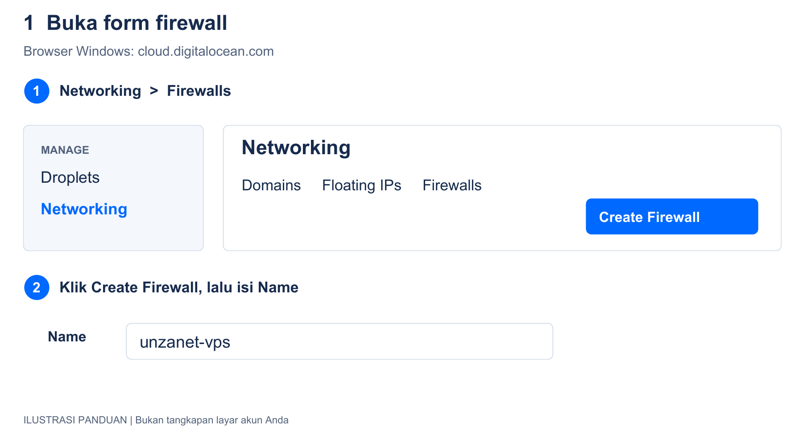
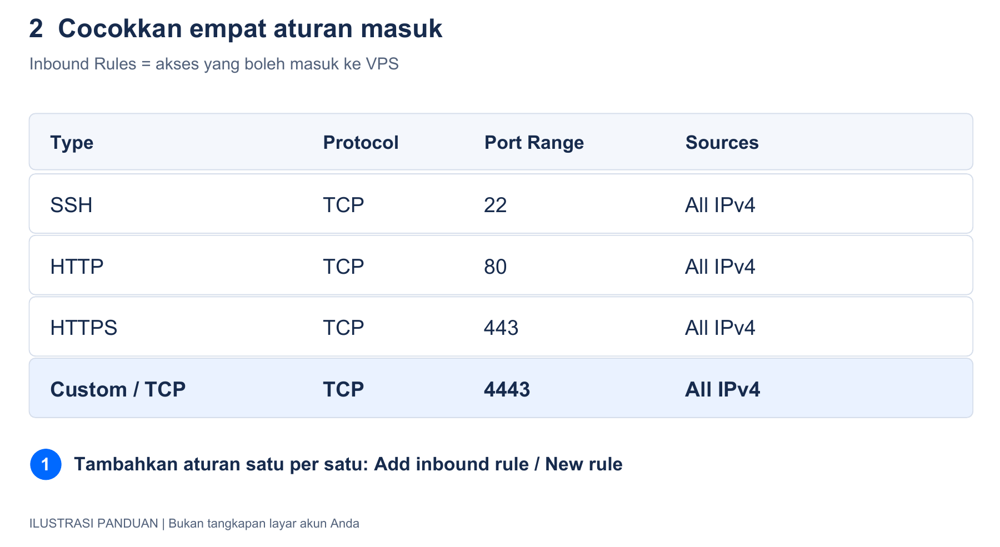
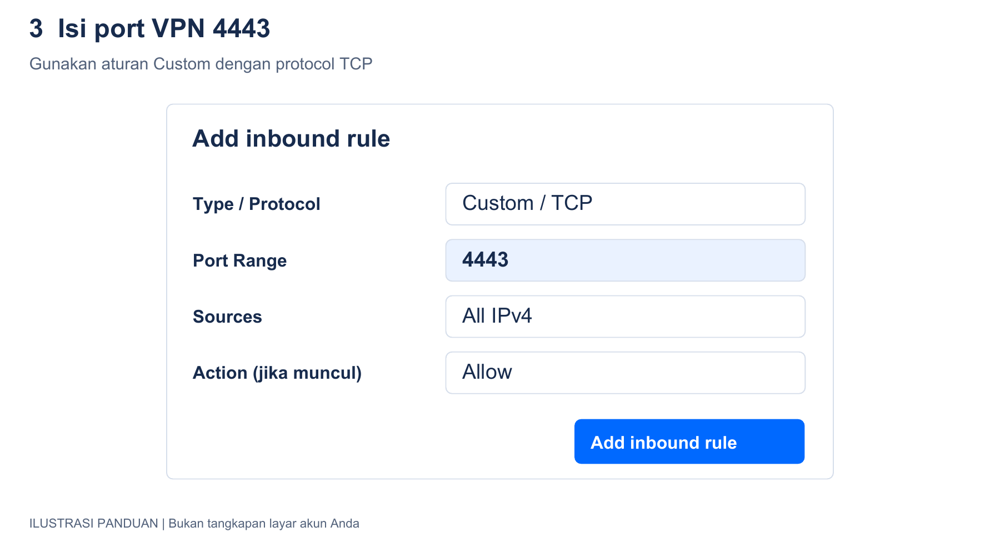
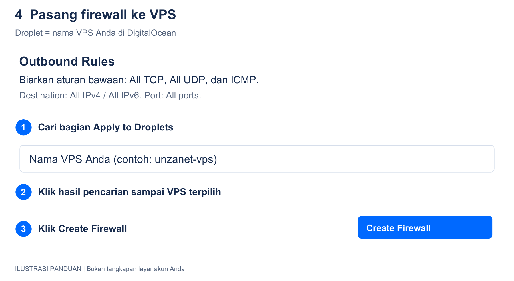
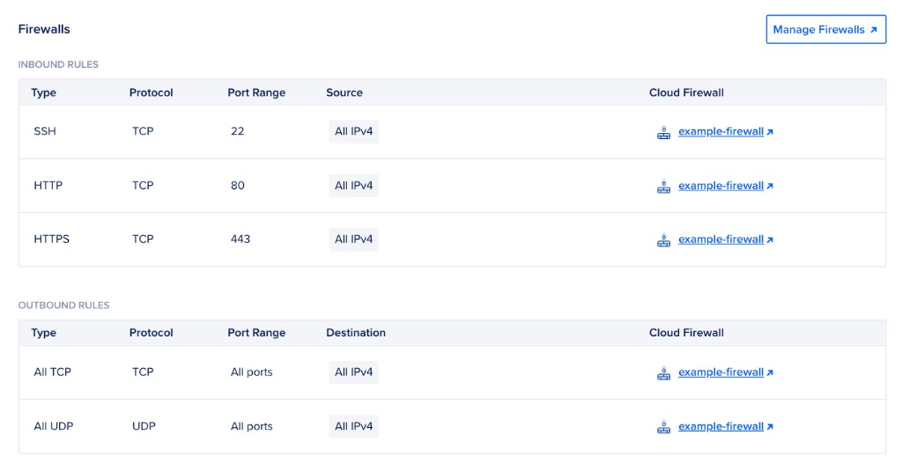

# Panduan Instalasi UNZANET di VPS

## 1 Siapkan VPS dan domain

1. Gunakan VPS Ubuntu Server 24.04 LTS baru dengan akses sudo, IPv4 publik, dan dukungan PPP kernel. Website, database, FreeRADIUS, dan server SSTP dipasang pada VPS yang sama.
2. Arahkan DNS A domain website ke IPv4 publik VPS. Ganti IP_VPS dan DOMAIN_WEBSITE pada langkah berikut dengan alamat Anda. Jika memakai Cloudflare: buka DNS > Records > Edit record website > matikan Proxied sampai DNS only berwarna abu-abu > Save. Tunggu DNS mengarah ke VPS sebelum instalasi.
3. Catat nama VPS dan IPv4 publik dari menu Droplets di DigitalOcean. Droplet adalah sebutan DigitalOcean untuk VPS. Contoh nama pada gambar: unzanet-vps; pilih nama VPS Anda sendiri.
4. Pastikan subnet 10.88.0.0/24 belum digunakan pada VPS maupun MikroTik. Server RADIUS memakai 10.88.0.1; router mendapat IP unik 10.88.0.2 sampai 10.88.0.254.

### 1.1 Buka halaman firewall DigitalOcean

1. Pada Chrome/Edge Windows, buka [panel DigitalOcean](https://cloud.digitalocean.com/) lalu login. Langkah firewall ini dikerjakan di browser, bukan di Terminal Ubuntu atau Winbox.
2. Di menu kiri, klik Networking, kemudian tab Firewalls. Klik Create Firewall. Jika menunya berbeda, tombol Create di bagian atas juga menyediakan pilihan Firewall.
3. Isi kolom Name dengan unzanet-vps atau nama yang mudah Anda ingat. Nama firewall tidak harus sama dengan nama VPS.

### 1.2 Isi aturan masuk satu per satu

1. Cari bagian Inbound Rules. Artinya: koneksi yang diizinkan masuk ke VPS. Pertahankan aturan SSH TCP 22 yang sudah ada agar Anda tetap bisa masuk melalui CMD.
2. Klik Add inbound rule. Pada tampilan lain tombolnya dapat tertulis New rule. Pilih Type HTTP; Protocol TCP dan Port 80 terisi otomatis. Pada Sources, pertahankan All IPv4. Jika kolom Action tersedia, pilih Allow. Klik Add inbound rule atau tombol simpan pada form.
3. Tambahkan aturan lagi dengan Type HTTPS. Pastikan Protocol TCP, Port 443, Sources All IPv4, dan Action Allow.
4. Tambahkan aturan VPN: Type Custom, Protocol TCP, Port 4443, Sources All IPv4, dan Action Allow. Simpan aturan ini.
5. All IPv4 berarti koneksi boleh datang dari alamat internet IPv4 mana pun. Jika All IPv6 juga sudah muncul secara bawaan, boleh dibiarkan. Setelah aturan disimpan, cocokkan keempat baris berikut:

6. Untuk port VPN, isi persis angka 4443. Jangan pilih UDP dan jangan membiarkan kolom Port kosong:

7. Pada Inbound Rules, cukup empat aturan di gambar. Jangan menambahkan All TCP atau All UDP sebagai aturan masuk. Port RADIUS 1812/1813, Disconnect 3799, dan MySQL 3306 tidak perlu dibuka ke internet; koneksi RADIUS berjalan melalui VPN.

### 1.3 Pilih VPS dan simpan firewall

1. Scroll ke Outbound Rules. Artinya: koneksi dari VPS menuju internet. Biarkan aturan bawaan All TCP, All UDP, dan ICMP menuju All IPv4/All IPv6 agar unduhan paket dan koneksi aplikasi berjalan.
2. Scroll ke Apply to Droplets. Ketik nama VPS Anda, lalu klik hasil pencariannya sampai VPS benar-benar terpilih. Jangan hanya mengetik namanya lalu melewati bagian ini.
3. Klik Create Firewall. Tunggu sampai halaman detail firewall muncul. Firewall baru bekerja pada VPS setelah VPS tersebut dipilih/ditambahkan.

4. Periksa: nama firewall sudah tampil, empat aturan masuk tersedia, dan VPS Anda terdaftar pada tab Droplets. Jika firewall sudah dibuat tetapi VPS belum masuk, buka tab Droplets pada firewall lalu tambahkan VPS tersebut.
5. Untuk melihat hasil dari sisi VPS, buka menu Droplets, klik nama VPS, buka Networking, lalu cari bagian Firewalls. Contoh tampilan asli dari dokumentasi DigitalOcean:

6. Gambar 1 sampai 4 adalah ilustrasi agar isian mudah ditiru. Nama menu mengacu ke dokumentasi DigitalOcean; susunan tampilan akun Anda dapat sedikit berbeda. Gambar 5 adalah screenshot resmi, bukan akun Anda.
7. Jika SSH atau website belum merespons, pastikan firewall dipasang pada VPS yang benar dan tidak ada aturan Deny dari firewall lain. Website/port VPN baru dapat merespons setelah layanannya dipasang pada tahap berikutnya.
8. Rujukan: [membuat firewall](https://docs.digitalocean.com/products/networking/firewalls/how-to/create/), [mengatur aturan](https://docs.digitalocean.com/products/networking/firewalls/how-to/configure-rules/), dan [melihat aturan pada VPS](https://docs.digitalocean.com/products/networking/firewalls/how-to/view-rules-for-droplet/). Diperiksa 20 Oktober 2026.

### 1.4 Masuk ke VPS dari CMD Windows

1. Setelah firewall terpasang, buka CMD Windows. Ganti USER_VPS dengan username Linux Anda dan IP_VPS dengan IPv4 publik VPS. Jika memakai login awal root dari DigitalOcean, USER_VPS adalah root:

~~~cmd
ssh USER_VPS@IP_VPS
~~~

2. Cocokkan fingerprint SSH melalui console DigitalOcean sebelum menerima host baru. Password SSH adalah password Linux VPS, berbeda dari akun VPN. Jika Anda memilih autentikasi SSH key saat membuat VPS, gunakan key yang sesuai; password akun DigitalOcean tidak dipakai untuk SSH.

## 2 Siapkan frontend di Windows

1. Gunakan folder project Windows yang sudah ada dan Node.js 22. Simpan perubahan kode frontend ke commit dahulu.
2. Jika frontend berubah atau paket belum tersedia, jalankan pada PowerShell Windows:

~~~powershell
cd "D:\1. Kuliah\Magang\Project Magang"
npm.cmd run preparefe
Get-Item .\releases\frontend.tar.gz
~~~

3. Commit dan push kode beserta releases/frontend.tar.gz ke GitHub. Server mengambil paket yang sama melalui clone/pull; Angular dibangun pada laptop.

## 3 Install aplikasi pada VPS

1. Jalankan pada SSH VPS:

~~~bash
sudo apt update
sudo apt install -y git curl ca-certificates python3
curl -fsSL https://deb.nodesource.com/setup_22.x -o /tmp/nodesource22.sh
sudo bash /tmp/nodesource22.sh
sudo apt install -y nodejs
node --version
~~~

2. Jika folder project belum ada, clone sekali:

~~~bash
sudo install -d -o "$USER" -g "$(id -gn)" /var/www/Project-Magang
git clone https://github.com/Gosfist/Project-Magang.git /var/www/Project-Magang
cd /var/www/Project-Magang
~~~

3. Jika folder sudah berisi repo, gunakan langkah ini tanpa clone ulang:

~~~bash
cd /var/www/Project-Magang
git status --short
git pull --ff-only
~~~

4. Simpan perubahan lokal sebelum pull. Jangan menghapus folder/database untuk mengatasi konflik.
5. Periksa paket lalu jalankan installer dari root project:

~~~bash
python3 scripts/frontend-prebuilt.py --check
npm run install
~~~

| Isian installer | Nilai |
| --- | --- |
| URL browser | https://DOMAIN_WEBSITE |
| IPv4 publik VPS untuk VPN | IP_VPS, tanpa https atau port |
| Email sertifikat HTTPS | Email aktif Anda, untuk pemberitahuan sertifikat |

6. Akun administrator awal dibuat otomatis: email admin@unzanet.com dan password 123. Installer tidak meminta isian email/password administrator.
7. Tunggu installer memasang aplikasi, HTTPS Certbot dan pembaruan otomatisnya, server SSTP TCP 4443, CA, serta worker akun VPN. Tidak perlu menjalankan Certbot atau npm run setupvpnserver terpisah. Email sertifikat berbeda dari akun admin dan harus email aktif.
8. Gunakan VPS/database baru; database.sql hanya diimpor pada database kosong. Update kode tidak memigrasikan skema database lama. Instalasi web lama dapat dilengkapi dengan git pull --ff-only lalu npm run install; isian gabungan ditanyakan sekali tanpa mereset akun/data.

## 4 Periksa HTTPS website

1. Pastikan installer menampilkan HTTPS origin terverifikasi dan Aplikasi siap dibuka. Periksa pada SSH VPS:

~~~bash
sudo apache2ctl configtest
sudo systemctl is-active certbot.timer
sudo ss -ltnp 'sport = :443'
~~~

2. Buka https://DOMAIN_WEBSITE. Jika memakai Cloudflare: buka SSL/TLS > Overview > pilih Full (strict). Setelah itu buka DNS > Records > Edit record website > aktifkan Proxied berwarna oranye > Save. Buka ulang website dan pastikan HTTPS valid sebelum login. Rujukan: [Full strict Cloudflare](https://developers.cloudflare.com/ssl/origin-configuration/ssl-modes/full-strict/).
3. Jika muncul 521/522, periksa DNS dan firewall provider 80/443, ubah sementara ke DNS only, lalu ulangi npm run install. Installer tidak melaporkan selesai jika sertifikat atau koneksi HTTPS origin gagal.
4. Jika URL hanya http://IP_VPS, installer menyediakan HTTP tanpa sertifikat domain. Untuk instalasi HTTPS, isi domain website pada isian awal. Website memakai 80/443; SSTP memakai 4443 pada IP VPS yang sama.

## 5 Periksa server VPN pada VPS yang sama

1. Server VPN sudah dipasang oleh npm run install. Periksa:

~~~bash
sudo systemctl is-active accel-ppp
sudo systemctl is-active unzanet-vpn-sync.timer
sudo systemctl is-active unzanet-vpn-ping
ip -4 address show dev lo
sudo ss -ltnp 'sport = :4443'
sudo freeradius -XC
~~~

2. Pastikan 10.88.0.1/32 terpasang pada lo dan TCP 4443 mendengarkan. Tidak perlu akun VPN Ubuntu atau menjalankan npm run setupvpn.
3. Sertifikat TLS tetap dipakai server SSTP dan private key tetap pada VPS. Script MikroTik versi sederhana tidak mengimpor CA dan menonaktifkan verifikasi sertifikat server. Pengulangan installer mempertahankan sertifikat dan akun VPN.

## 6 Login dan buat klien VPN

1. Buka https://DOMAIN_WEBSITE dan gunakan akun awal berikut:

| Isian login | Nilai |
| --- | --- |
| Email | admin@unzanet.com |
| Password | 123 |

2. Klik Login. Jika password pernah Anda ubah melalui profil, gunakan password terbaru; mengulang installer tidak mereset password akun yang sudah ada.
3. Buka Router > Klien VPN > Tambah VPN.

| Isian | Contoh |
| --- | --- |
| Nama | Router Cabang 1 |
| Username | vpn_router01 |
| Password | Kosongkan untuk password acak atau isi minimal 12 karakter |

4. Klik Buat Akun VPN. Tunggu penerapan ke server sekitar 15 detik. Gunakan Muat Ulang bila perlu.
5. Daftar menampilkan No, Nama, Username, Password langsung, IP VPN, Router / NAS, dan Aksi. Tidak ada kolom Status atau tombol Tampilkan/Sembunyikan.
6. Klik ikon pensil untuk Edit. Ganti nama, username atau password lalu klik Simpan Perubahan. Password kosong saat edit mempertahankan password lama; IP VPN tetap. Jika username/password berubah, tunggu sekitar 15 detik lalu buka Winbox > Interfaces > pilih radius-cloud-ID_NAS > tab Dial Out, ubah User/Password, lalu Apply. Jangan paste ulang script add untuk mengganti kredensial tunnel yang sudah ada.
7. Klik ikon tempat sampah untuk Hapus, lalu konfirmasi. Akun yang masih dipakai NAS harus dilepas/diganti pada NAS dahulu. Penghapusan diterapkan ke file akun server sekitar 15 detik; sesi tunnel yang sudah tersambung tidak diputus otomatis.

## 7 Tambah Router NAS dari klien VPN

1. Buka Router > Router / NAS > Tambah Router NAS. Pilih klien VPN yang sudah dapat dipilih dan belum dipakai router lain. Jika opsi masih Menunggu server, tutup form lalu buka kembali setelah sekitar 15 detik; jika tetap menunggu, periksa worker pada bagian 9.2.

| Isian | Nilai |
| --- | --- |
| Nama Router | MikroTik Cabang 1 |
| Klien VPN | vpn_router01 dan IP yang tampil |
| IP NAS dan Disconnect | Otomatis dari klien VPN |
| IP Server RADIUS | Otomatis 10.88.0.1 |
| Port autentikasi dan Disconnect | 1812 dan 3799 |
| Shared secret | Kosongkan untuk nilai acak |

2. Klik Simpan & Buat Script. Pilih versi RouterOS 6/7 sesuai perangkat, lalu salin script.
3. Buka Winbox > New Terminal pada MikroTik tujuan. Paste script dari web. Tiga bagiannya mengatur SSTP port 4443, RADIUS/Disconnect beserta rute dan firewall, lalu PPP AAA/accounting. Tidak ada blok impor CA.
4. Host, IP, username dan password otomatis berasal dari klien terpilih. Script langsung memakai add tanpa :if atau pemeriksaan duplikat. Gunakan sekali untuk pemasangan awal. Paste ulang dapat membuat RADIUS/rute/firewall ganda atau gagal karena nama tunnel sudah dipakai.
5. Tunggu penerapan NAS ke FreeRADIUS sekitar 60 detik. Kolom Status VPN mengikuti sesi SSTP, bukan tanda pendaftaran NAS. Online berarti username dan IP VPN cocok dengan sesi SSTP active di server; tabel sesi kosong berarti Offline. Pemeriksaan gagal/data lebih dari 45 detik tampil Tidak diketahui; NAS lokal tampil Tanpa VPN. Web memuat ulang status setiap 15 detik, pengumpul sesi setiap 10 detik. Simpan NAS belum membuktikan script sudah dipasang pada MikroTik.
6. Mode sederhana memakai verify-server-certificate=no dan verify-server-address-from-certificate=no. Trafik tetap memakai TLS, tetapi identitas server tidak diverifikasi sehingga berisiko tersambung ke server palsu dan kredensial VPN dapat diserang. VPN tidak otomatis aman hanya karena terenkripsi. Rujukan: [sertifikat SSTP MikroTik](https://help.mikrotik.com/docs/spaces/ROS/pages/2031645/SSTP).

## 8 Periksa tunnel dan uji PPPoE

1. Jalankan pada Terminal MikroTik:

~~~routeros
/interface sstp-client print detail
/ping 10.88.0.1 count=5
/radius print detail
/radius incoming print
/ppp aaa print
~~~

2. Pastikan tunnel running, port 4443, use-radius=yes, accounting aktif, dan incoming Disconnect port 3799. Script sederhana tidak memverifikasi sertifikat server.
3. Pada SSH VPS, ganti IP_KLIEN_VPN dengan IP dari daftar:

~~~bash
sudo accel-cmd show sessions
ping -c 5 IP_KLIEN_VPN
ip route get IP_KLIEN_VPN
sudo systemctl status unzanet-radius-nas-refresh.timer --no-pager
~~~

4. Cocokkan username/IP sesi dengan klien yang dipilih pada NAS. Rute VPS harus menuju interface SSTP router tersebut.
5. Siapkan PPPoE Server pada interface pelanggan yang benar dan profil PPP dengan local-address valid. Daftarkan IP Pool serta Harga Paket di website dan pasang script pool pada router yang sama.
6. Buat/aktifkan akun pelanggan dengan NAS tersebut. Dial dari perangkat pelanggan memakai username/password PPPoE, terpisah dari akun VPN router.

~~~routeros
/ppp active print
/log print where topics~"radius|ppp|sstp"
~~~

7. Periksa Monitoring RADIUS dan accounting Start/Interim. Uji Putus Sesi, isolir, serta pemulihan; pastikan sesi nyata terputus/tersambung dan menerima pool/profil yang sesuai.
8. Buka Login Bot Wa lalu pindai QR menggunakan ponsel jika memakai Bot WhatsApp.

## 9 Pemulihan dan perawatan

### 9.1 Installer berhenti saat menyiapkan firewall

1. Jika log berhenti setelah Menyiapkan firewall dan service otomatis saat boot, versi lama dapat menunjukkan baris 223. Pada versi itu perintah sshd -T membaca port SSH, tetapi pesan errornya disembunyikan. Jalankan pada SSH VPS yang masih terbuka:

~~~bash
sudo /usr/sbin/sshd -T 2>&1 | head -n 12
~~~

2. Jika muncul Missing privilege separation directory: /run/sshd, buat folder runtime lalu periksa konfigurasi SSH:

~~~bash
sudo install -d -o root -g root -m 0755 /run/sshd
sudo /usr/sbin/sshd -t
~~~

3. Jika sshd -t selesai tanpa pesan error, jalankan installer kembali dari folder project:

~~~bash
cd /var/www/Project-Magang
npm run install
~~~

4. Ulangi instalasi tanpa menghapus database atau membangun ulang frontend. Jika muncul error SSH lain, kirim pesan lengkapnya; jangan melewati pemeriksaan atau menebak port firewall. Pertahankan sesi SSH yang masih tersambung.
5. AH00558 dengan Syntax OK adalah peringatan Apache; npm notice juga bukan kegagalan instalasi. Rujukan: [ServerName Apache](https://httpd.apache.org/docs/2.4/mod/core.html#servername).
6. Jika tempelan memunculkan ^[[200~ atau ^[[201~ dan command not found, tekan Ctrl+C. Ketik manual bind 'set enable-bracketed-paste off' lalu Enter. Tempel satu perintah setiap kali, tekan Enter dan tunggu selesai. Jangan ikut menyalin tulisan root@server atau tanda #.

### 9.2 Akun VPN dan sertifikat

1. Jika pilihan akun pada form Router / NAS terus Menunggu server, jalankan pada SSH VPS:

~~~bash
sudo systemctl status unzanet-vpn-sync.service --no-pager
sudo systemctl start unzanet-vpn-sync.service
sudo cat /var/lib/unzanet-vpn/last-error
~~~

2. Jika last-error tidak ada, baca status service dan muat ulang daftar. Periksa kecocokan skema database dan secret instalasi. Jangan mengganti JWT_SECRET untuk mencoba memperbaiki dekripsi password.
3. Jika SSTP gagal, periksa:

~~~bash
sudo journalctl -u accel-ppp -n 80 --no-pager
sudo tail -n 80 /var/log/accel-ppp/auth-fail.log
sudo ufw status numbered
sudo ss -ltnp 'sport = :4443'
~~~

4. Cocokkan IP publik, username/password VPN, serta firewall provider TCP 4443. Script sederhana tidak memerlukan impor CA di MikroTik. Jangan membagikan private key atau screenshot kredensial.
5. Jika EAP FreeRADIUS gagal saat install, jalankan git pull --ff-only lalu npm run install kembali. Installer menonaktifkan modul EAP bawaan yang tidak dipakai, tanpa menghapus database.
6. Jika setup VPN terhenti setelah konfigurasi dibuat, periksa error dahulu. Pasang ulang worker tanpa menimpa sertifikat/akun:

~~~bash
cd /var/www/Project-Magang
sudo bash scripts/setup-vpn-sync.sh
sudo systemctl restart unzanet-vpn-ping accel-ppp unzanet-backend
~~~

7. Sertifikat SSTP berlaku 365 hari. Periksa tanggal sebelum kedaluwarsa:

~~~bash
sudo openssl x509 -in /etc/sstp-vpn/server.crt -noout -dates
~~~

8. Perbarui dengan CA yang sama pada SSH VPS. IP publik harus masih sesuai server.ext:

~~~bash
sudo openssl x509 -req -in /etc/sstp-vpn/server.csr \
  -CA /etc/sstp-vpn/ca.crt -CAkey /etc/sstp-vpn/ca.key \
  -CAcreateserial -out /etc/sstp-vpn/server.crt \
  -days 365 -sha256 -extfile /etc/sstp-vpn/server.ext
sudo sh -c 'cat /etc/sstp-vpn/server.crt /etc/sstp-vpn/ca.crt > /etc/sstp-vpn/server-chain.pem'
sudo systemctl restart accel-ppp
~~~

9. Restart SSTP menyambung ulang tunnel router. Jadwalkan perawatan dan periksa sesi/accounting sesudahnya. HTTPS website diperbarui terpisah melalui Certbot.
10. Backup database, uploads, secret instalasi, dan CA/private key secara privat. npm run update hanya memperbarui kode, tanpa memigrasikan database lama.

### 9.3 Menu tidak berpindah dan file halaman gagal dimuat

1. Jika klik menu membuat URL tetap /dashboard, buka Console dengan Ctrl+Shift+J. Pesan Failed to fetch dynamically imported module menunjukkan file JavaScript halaman gagal dimuat. Catat nama file chunk dari pesan tersebut.
2. Jika halaman bisa dibuka lewat URL langsung, tekan Ctrl+Shift+R pada tab dashboard lama lalu coba menu lagi. Ini memuat ulang browser, bukan npm run update dan bukan instalasi ulang VPS. Browser akan memuat ulang aplikasi beserta file halamannya.
3. Jika masih gagal, tutup tab dashboard lama dan buka https://DOMAIN_WEBSITE/dashboard pada tab baru. Coba Data Pelanggan, Harga Paket, IP Pool, dan Isolir PPPoE. Login kembali jika sesi memang sudah berakhir.
4. Jika tetap gagal, buka F12 > Network, aktifkan Preserve log, lalu klik menu sekali. Pilih permintaan chunk yang merah dan kirim Request URL, Status Code, serta Content-Type. Respons JavaScript yang benar harus berisi JavaScript; respons HTML atau 404 perlu diperiksa pada file frontend dan cache CDN.
5. Jika file versi yang dibutuhkan hilang, pastikan kode dan releases/frontend.tar.gz yang cocok sudah di-push ke GitHub, lalu jalankan npm run updatefe pada VPS. Paket dibangun di laptop sesuai tahap 2. Jangan membangun Angular di VPS, menghapus chunk lama, atau mengganti label Content-Type HTML menjadi JavaScript.
6. URL langsung yang berhasil dan file chunk yang kembali merespons benar tidak memerlukan perubahan akun RADIUS, firewall VPN, atau skema database. Jika respons file masih 403, periksa aturan akses/CDN untuk permintaan tersebut sebelum mengubah konfigurasi aplikasi.

### 9.4 Terminal MikroTik menampilkan bad parameter allow

1. Pesan bad parameter allow saat paste script berarti perintah SSTP gagal; konfigurasi mungkin baru terpasang sebagian. Jangan menganggap tunnel dan RADIUS sudah aktif hanya karena terminal kembali menampilkan prompt.
2. Parameter klien SSTP yang benar adalah authentication=mschap2. Jika memakai script lama, salin ke Notepad Windows lalu Ctrl+H untuk mengganti allow=mschap2 menjadi authentication=mschap2. Pada pemasangan baru gunakan script yang sudah diperbaiki. Jika sebagian konfigurasi sudah terpasang, jangan paste ulang semua perintah add; periksa entri yang sudah ada melalui Winbox. Simpan script secara privat karena memuat kredensial.
3. Untuk memasang perbaikan permanen, setelah kode terbaru di-push ke GitHub jalankan npm run updatebe pada VPS. Buka ulang Router / NAS > Script dan salin ulang script untuk router yang sama. Perbaikan template ini hanya di backend; tidak perlu membangun ulang frontend khusus untuk perbaikan ini.
4. Template terbaru langsung memakai add tanpa pemeriksaan entri lama. Untuk konfigurasi yang sudah terpasang, ubah parameter interface melalui Winbox; jangan paste ulang script add. Tidak perlu menghapus sertifikat, tunnel lain, atau konfigurasi PPPoE. Script unduhan lama tidak berubah otomatis.
5. Periksa pada Terminal MikroTik:

~~~routeros
/interface sstp-client print
/ip address print
/radius print
/ppp aaa print
/ping 10.88.0.1 count=5
~~~

6. Interface radius-cloud-ID_NAS harus memiliki tanda R (running), mendapat IP VPN sesuai akun, use-radius=yes, dan ping gateway berhasil. Ini membuktikan tunnel/jalur dasar; lanjutkan dial PPPoE nyata, accounting, dan Disconnect sesuai tahap 8. Rujukan: [properti klien SSTP MikroTik](https://help.mikrotik.com/docs/spaces/ROS/pages/2031645/SSTP).

### 9.5 Memasang template MikroTik sederhana tanpa impor CA

1. Setelah kode terbaru di-commit dan di-push ke GitHub, jalankan npm run updatebe pada SSH VPS. Perubahan template dihasilkan backend; tidak perlu build Angular khusus untuk template ini.
2. Untuk router yang belum dikonfigurasi, buka Router > Router / NAS > Script, salin script terbaru, lalu paste ke Terminal MikroTik sekali. Script terdiri dari tiga bagian dengan perintah add langsung, tanpa :if dan tanpa impor CA. Untuk router yang sudah dikonfigurasi, ubah entri melalui Winbox; script tidak memperbarui atau menghapus entri lama.
3. Jika juga menerapkan perubahan UI Klien VPN/Router sebelumnya, commit perubahan frontend di laptop, jalankan npm.cmd run preparefe, lalu commit/push releases/frontend.tar.gz bersama perubahan kode. Sesudah itu jalankan npm run update pada VPS untuk backend dan frontend sekaligus. Jangan membangun Angular di VPS.
4. Periksa tunnel dan ping sesuai tahap 8. Tidak ada impor CA atau verifikasi identitas server pada mode sederhana; sertifikat TLS di VPS tetap diperlukan. Jangan menyatakan PPPoE berhasil sebelum dial dan accounting benar-benar diuji.

### 9.6 Memeriksa status Online atau Offline VPN di Router NAS

1. Kolom Status VPN memakai hasil accel-cmd show sessions. Hanya sesi bertipe sstp dengan state active dan username/IP cocok yang tampil Online. Akun dibuat atau pendaftaran NAS aktif belum membuktikan VPN tersambung.
2. Jika hasil show sessions hanya judul tabel tanpa baris sesi, status akun VPN terkelola adalah Offline. Tunggu sekitar 25 detik agar pengumpul sesi dan pemuatan ulang web selesai. Status VPN tidak membuktikan PPPoE pelanggan sudah berfungsi.
3. Setelah kode dan paket frontend terbaru yang cocok di-push ke GitHub, jalankan npm run update pada VPS. Pembaruan backend memasang timer pengumpul sesi otomatis. Paket frontend tetap dibangun di laptop dengan npm.cmd run preparefe setelah perubahan frontend di-commit, kemudian commit/push paketnya.
4. Jika tampil Tidak diketahui, jalankan pada SSH VPS:

~~~bash
sudo systemctl status unzanet-vpn-status.timer --no-pager
sudo systemctl start unzanet-vpn-status.service
sudo journalctl -u unzanet-vpn-status.service -n 30 --no-pager
sudo accel-cmd show sessions username,ip,type,state
~~~

5. Tidak diketahui berarti data gagal/usang, pengumpul belum tersedia, atau akun eksternal. Pengumpul hanya membaca sesi tanpa API MikroTik. Rujukan: [kolom sesi Accel-PPP](https://docs.accel-ppp.org/configuration/cli.html).
